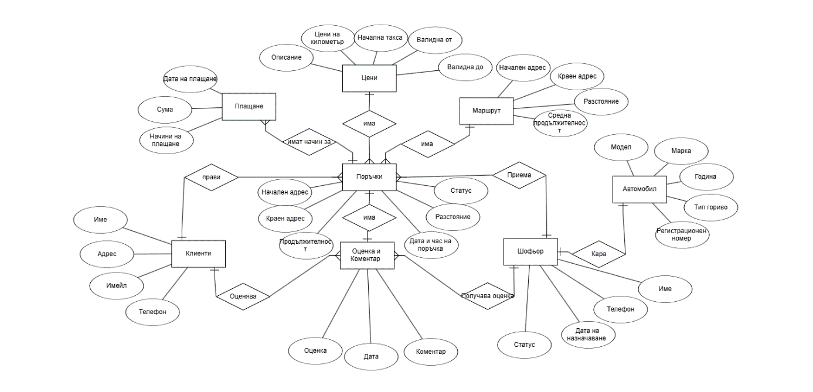
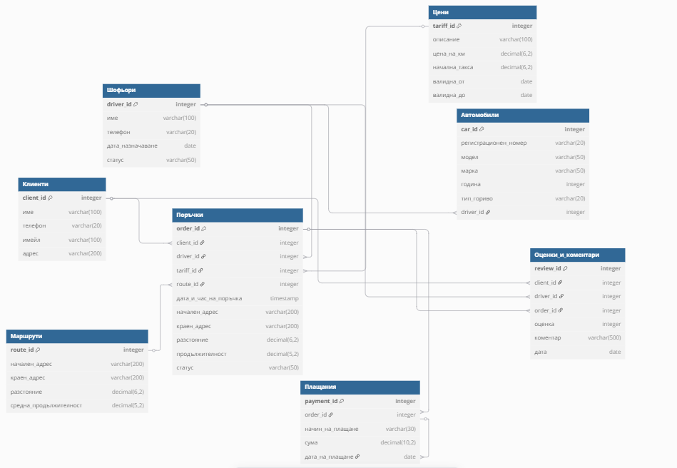

# Taxi Company Management Database

## Project Overview

This project is a relational database designed to manage the operations of a taxi company. It stores information about customers, drivers, vehicles, prices, routes, orders, payments, and customer reviews.

The database is implemented in Oracle SQL and is intended to demonstrate practical database design, table creation, sample data insertion, and SQL querying.

## Database Structure

The system contains the following eight tables:

1. **Customers** (`Клиенти`) — stores customer information.
2. **Drivers** (`Шофьори`) — stores driver information.
3. **Vehicles** (`Автомобили`) — stores information about the company's vehicles.
4. **Prices** (`Цени`) — stores pricing information.
5. **Routes** (`Маршрути`) — stores route information.
6. **Orders** (`Поръчки`) — stores taxi orders.
7. **Payments** (`Плащания`) — stores payment information.
8. **Reviews and Comments** (`Оценки_и_коментари`) — stores customer ratings and feedback.

The tables are designed to model the main business flow of a taxi service: customer → order → route → payment → review.

## Database Diagrams

### Entity-Relationship Diagram



### Relational Schema



## Technologies Used

- Oracle Database
- Oracle SQL
- SQL scripts for database creation and sample data insertion

## Repository Structure

```text
oracle-taxi-company/
├── README.md
├── docs/
│   ├── er-diagram.png
│   ├── relational-schema.png
│   ├── original-document.docx
│   └── original-document-english.txt
├── sql/
│   ├── 01_create_tables.sql
│   └── 02_sample_data.sql
├── queries/
│   └── queries.md
└── LICENSE (optional if added later)
```

## Documentation

The project documentation is located in the `docs/` folder. It contains the detailed original project description, schema explanations, and visual diagrams.

The SQL query descriptions and examples are stored in the `queries/` directory.

## SQL Query Folder

The `queries/` folder contains SELECT statements and explanations for the main database operations. These queries are meant to demonstrate how to:

- retrieve customer data;
- view driver and vehicle information;
- inspect route and order details;
- calculate payment totals;
- analyze ratings and comments;
- use joins between related tables.

## Getting Started

To set up the database:

1. Open Oracle SQL Developer or another Oracle-compatible SQL environment.
2. Connect to your Oracle Database instance.
3. Execute `sql/01_create_tables.sql` to create the tables and constraints.
4. Execute `sql/02_sample_data.sql` to insert sample data.
5. Review and run the queries in `queries/queries.md` to explore the database.

Execute the scripts in the order shown above.

## Business Flow

A typical workflow in this system is:

1. A customer is registered in the `Клиенти` table.
2. A taxi order is created in `Поръчки`.
3. A route is assigned from the `Маршрути` table.
4. Driver and vehicle information are linked to the order.
5. Payment details are recorded in `Плащания`.
6. The customer can leave feedback in `Оценки_и_коментари`.

This flow reflects a realistic taxi company process and demonstrates how relational database design supports business operations.

## Project Purpose

The purpose of this project is to apply database design and SQL programming concepts to a practical business scenario. It demonstrates how a relational database can organize and manage the main operations of a taxi company.

## Notes

- Table and column names are kept in Bulgarian to match the original SQL scripts.
- Sample data should be checked before executing all insert statements to ensure referenced records exist.
- The project reflects an academic database design and is intended for learning and demonstration.
- Full detailed documentation is available in the `docs/` folder.

---

**Project:** Taxi Company Management Database  
**Database Technology:** Oracle SQL
